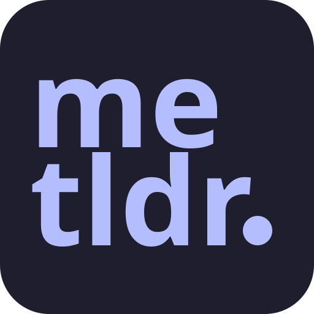

<p align="center">
  
</p>

<p align="center">
  <a href="https://chromewebstore.google.com/detail/kbfdmfgmmibkdnbfdaeganjckfgbfjlh">
    
  </a>
  <a href="https://chromewebstore.google.com/detail/kbfdmfgmmibkdnbfdaeganjckfgbfjlh">
    
  </a>
</p>

> **metldr** is a privacy first, local ai powered chrome extension designed to enhance productivity by integrating summarisation, smart replies, and dictionary lookups directly into your browser.

## install

- **chrome web store**: https://chromewebstore.google.com/detail/kbfdmfgmmibkdnbfdaeganjckfgbfjlh

## features

- **email intelligence**: automatically summarises threads, extracts key facts (dates, amounts), and generates context aware reply suggestions in gmail.
- **page intelligence**: detects article content, provides bulleted summaries, and allows you to chat with any webpage.
- **pdf intelligence**: full featured pdf reader with summarisation, q&a (rag), and local file support.
- **instant definitions**: three tier dictionary lookup (local > api > llm) for instant word definitions.
- **privacy first**: runs entirely on device using chrome built in ai (gemini nano) or local ollama models.

## usage

### setting up ai providers

#### option 1: chrome built in ai (recommended)

metldr uses chrome's built in gemini nano model by default.

1. ensure you are on chrome version 138+
2. enable "prompt api for gemini nano" in `chrome://flags`
3. the extension will automatically detect availability

#### option 2: ollama (for power users)

run larger models (llama 3, qwen, etc.) locally on your machine.

1. install [ollama](https://ollama.com)
2. run a model: `ollama run llama3.2`
3. go to metldr settings > ai provider > select "ollama"
4. ensure ollama is running at `http://127.0.0.1:11434`

## development

### Rust core

The Rust core runs through WebAssembly. It decodes Ollama chat streams while preserving text spacing and handling thinking tags across fragments. Invalid records and responses that end before a completion record report an error. Each stream record is limited to 256 KiB.

Retrieval text chunking also runs in the Rust core. It keeps the existing email, article and PDF window sizes and overlap. Offsets count UTF16 units in normalized text, and chunks keep Unicode characters intact at their boundaries.

The welcome page runs in Rust through WebAssembly, with static Help available while it loads. It checks Chrome AI or Ollama only when requested, saves setup before closing, and shows the extension's exact origin in Ollama setup commands. Its former Vue entry is removed. The side panel still uses Vue while its Rust replacement is developed.

Install Rust and the matching binding generator before building the extension. The repository pins Rust 1.99.1.

```sh
rustup target add wasm32-unknown-unknown
cargo install wasm-bindgen-cli --version 0.2.128 --locked
npm ci
```

Use the mise managed Portless CLI for local previews. `npm run dev` builds Rust and starts Portless with the project name `metldr`. Open the URL it prints, then add `/welcome.html` for welcome or `/index.html` for the panel layout. Chrome extension APIs require the loaded extension, so a web preview does not establish working AI or browser controls.

To check the extension, build it and load the `dist` directory with Load unpacked at `chrome://extensions`. The toolbar icon opens the side panel. Open welcome from the panel, or copy the extension ID from Chrome's extensions page and open `chrome-extension://YOUR_EXTENSION_ID/welcome.html`. After another build, reload the extension from Chrome's extensions page before checking changes.

The development server and the main and content builds prepare the Rust bindings and welcome generator automatically. After editing Rust during a development session, run `npm run build:rust` again and reload the extension or development page. The welcome HTML template is rendered by the Rust generator in both Vite development and production builds. Generated bindings and Cargo build output are local build products.

```sh
make rust
make check-rust
cargo test --locked --manifest-path crates/metldr-core/Cargo.toml
cargo test --locked --manifest-path crates/metldr-welcome/Cargo.toml
```

### commands

| command                   | description                                |
| :------------------------ | :----------------------------------------- |
| `npm run dev`             | start development server (hmr for ui)      |
| `npm run build`           | build all targets (main, content, sandbox) |
| `npm run type-check`      | run typescript validation                  |
| `npm run download:models` | download required ai models to public/     |

## privacy

metldr is designed with a strict privacy first architecture:

- **local execution**: all ai processing happens on your device (via chrome ai or localhost ollama).
- **no data collection**: we do not collect, store, or transmit your emails, browsing history, or personal data.
- **offline capable**: core features work without internet access.

---

_built with ❤️ by efaz_
